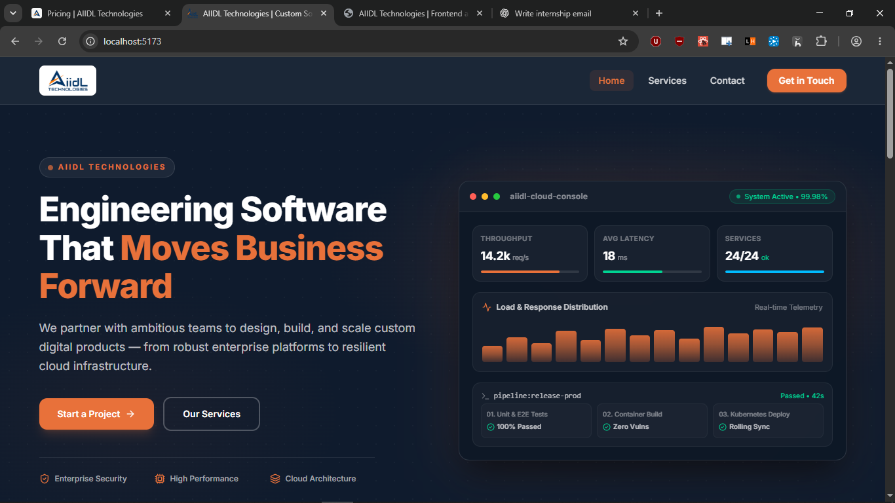
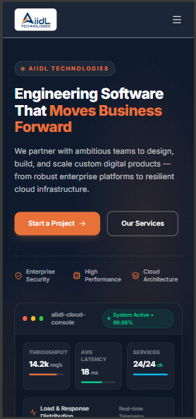

# AIIDL Technologies — Website Challenge

A responsive, multi-page website built for the AIIDL Technologies Frontend & UI/UX Candidate Assignment.

## Overview

The goal of this project is to create a clear, engaging web experience that helps founders and small-business teams understand AIIDL Technologies' services, explore sample project concepts, and get in touch.

The website focuses on visual hierarchy, responsive layouts, accessible interactions, and a consistent design system.

## Pages

- **Home:** Hero section, service summaries, concept project cards, and calls to action.
- **Service Detail:** Custom Software Development overview, deliverables, a three-step process, FAQs, and a contact CTA.
- **Contact:** Enquiry form with client-side validation and success feedback.

## Tech Stack

- React
- Vite
- Tailwind CSS v4
- React Router
- Lucide React

## Getting Started

### Prerequisites

- Node.js and npm installed.

### Installation

1. Clone the repository or download the source code.
2. Open a terminal in the project directory.
3. Install the dependencies:

```bash
  npm install
```

4. Start the development server:

```bash
  npm run dev
```

5. Open the local URL displayed in the terminal.

### Production Build

Run the following command to create a production build:

```bash
npm run build
```

To preview the production build locally:

```bash
npm run preview
```

## Design Concept

The visual direction combines a deep navy background, warm neutral surfaces, and orange accents to create a modern software-development brand experience.

The design aims to communicate technical capability while keeping the content approachable and easy to navigate.

### Key Design Decisions

1. **Clear visual hierarchy:** A prominent hero headline and primary call to action help visitors quickly understand the purpose of the website.
2. **Product-inspired hero visual:** A dashboard-style illustration reinforces the software engineering theme without relying on external image assets.
3. **Consistent visual language:** Shared navigation, reusable components, typography, spacing, and colors maintain consistency across all three pages.
4. **Responsive layouts:** Content adapts to desktop and mobile screens to keep navigation and page sections usable at different widths.

## Functionality and Accessibility

- Navigation between all three pages.
- Working calls to action that lead to the relevant pages.
- Responsive navigation for smaller screens.
- Accessible, keyboard-operable FAQ interactions.
- Contact form validation for required fields, whitespace-only text, and invalid email addresses.
- Inline validation feedback and preservation of entered values.
- A demo-only success message after valid form submission.
- Visible keyboard focus indicators and meaningful form labels.

**Contact form notice:** The form is a frontend demonstration. It does not send emails or persist enquiries to a backend.

## AI and Reference Disclosure

AI assistance was used for design exploration, implementation guidance, and code refinement. The final implementation was reviewed and refined during development.

**Tools used:** ChatGPT and OpenAI Codex, along with React, Vite, Tailwind CSS, and Lucide React.

**Reference:** [AIIDL Technologies](https://aiidltechnologies.com/) was used for company context and branding.

### Representative AI Prompt

"Create a distinctive, responsive technology-company website for AIIDL Technologies using React and Tailwind CSS. Include a homepage, a Custom Software Development detail page, and a contact page. Use a deep navy, warm neutral, and orange color palette. Prioritize visual hierarchy, accessibility, working navigation, form validation, and maintainable components."

### Improvements Made During Review

- Improved the logo's visibility against the dark navigation background.
- Refined the homepage hero with a dashboard-style visual to balance the headline and supporting content.
- Reviewed typography, spacing, navigation behavior, and responsive layout to improve usability.

## Testing and Quality Checks

The following checks were performed on the final implementation.

| Check                                   | Result |
| --------------------------------------- | ------ |
| Production build (`npm run build`)      | Passed |
| Navigation between all three pages      | Passed |
| Desktop layout at approximately 1280px  | Passed |
| Mobile layout at approximately 390px    | Passed |
| Contact form validation                 | Passed |
| Successful demo form submission         | Passed |
| Keyboard navigation and FAQ interaction | Passed |
| Horizontal overflow and broken assets   | Passed |

## Screenshots

### Desktop Homepage



### Mobile Homepage



## Time Spent

Total development time: 3 HOURS

## Limitations

- The contact form is simulated and does not deliver or store enquiries.
- The sample projects are illustrative concepts, not claims of completed client engagements.

## Submission

This repository contains the source code and project documentation for the AIIDL Technologies Frontend & UI/UX Candidate Assignment.
